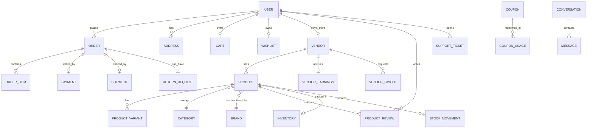

# ShopSphere — Database Documentation

ShopSphere utilizes **MongoDB** with **Mongoose ODM**. This document outlines all schemas, relationships, indexing strategies, and transactional business rules.

---

## 1. Entity-Relationship Overview

---

## 2. Core Entities & Schemas

### `User`
- **Fields:** `name`, `username` (sparse), `email` (unique), `password` (select: false), `role` (`user`, `vendor`, `admin`, `super_admin`), `avatar`, `phone`, `googleId` (sparse), `isEmailVerified`, `isActive`, `vendorId` (ref Vendor), `refreshToken` (select: false), `otp`, `otpExpires`, `passwordResetToken`.
- **Indexes:** `{ email: 1 }` (unique), `{ role: 1 }`, `{ googleId: 1 }`.

### `Vendor`
- **Fields:** `userId` (ref User, unique), `storeName`, `slug` (unique), `description`, `logo`, `banner`, `phone`, `email`, `address`, `businessDetails` (taxNumber, bankAccount), `commissionRate` (default 10%), `status` (`pending`, `under_review`, `approved`, `rejected`, `suspended`), `isActive`, `rating`, `numReviews`.
- **Indexes:** `{ slug: 1 }` (unique), `{ status: 1 }`, `{ userId: 1 }` (unique).

### `Product`
- **Fields:** `name`, `slug` (unique), `description`, `shortDescription`, `vendorId` (ref Vendor), `category` (ref Category), `brand` (ref Brand), `price`, `compareAtPrice`, `discountPercentage`, `stock`, `sku`, `images`, `status` (`draft`, `pending_approval`, `published`, `rejected`, `archived`), `rejectionReason`, `rating`, `numReviews`, `isActive`, `isFeatured`, `isTrending`, `isFlashSale`, `isBestSeller`, `isNewArrival`, `tags`, `attributes`, `hasVariants`.
- **Indexes:**
  - Text search: `{ name: 'text', description: 'text', tags: 'text' }`
  - Compound: `{ status: 1, isActive: 1 }`
  - Filter: `{ category: 1, status: 1 }`, `{ brand: 1, status: 1 }`, `{ price: 1 }`.

### `Order`
- **Fields:** `orderNumber` (unique), `userId` (ref User), `items` (embedded array of items with snapshot of product, variant, vendorId, name, price, quantity, total), `shippingAddress`, `paymentMethod`, `paymentStatus`, `paymentId` (ref Payment), `orderStatus`, `subtotal`, `taxPrice`, `shippingPrice`, `discountAmount`, `totalAmount`, `coupon`, `isPaid`, `paidAt`, `isDelivered`, `deliveredAt`, `tracking`, `cancellation`, `returnRequest`, `statusHistory`.
- **Indexes:** `{ orderNumber: 1 }` (unique), `{ userId: 1, createdAt: -1 }`, `{ 'items.vendorId': 1 }`.

### `Payment`
- **Fields:** `orderId` (ref Order), `userId` (ref User), `amount`, `currency` (INR), `paymentMethod`, `status`, `razorpayOrderId` (sparse), `razorpayPaymentId` (sparse), `razorpaySignature`, `isVerified`, `failureReason`, `metadata`.
- **Indexes:** `{ orderId: 1, status: 1 }`, `{ razorpayOrderId: 1 }`, `{ razorpayPaymentId: 1 }`.

### `Inventory` & `StockMovement`
- **`Inventory`:** `{ productId: 1 }` (unique), `variantId`, `vendorId`, `quantity`, `reservedQuantity`, `lowStockThreshold`, `isOutOfStock`.
- **`StockMovement`:** Tracks every quantity adjustment with audit trail: `{ productId, variantId, vendorId, type: ['IN', 'OUT', 'ADJUSTMENT', 'RETURN', 'CANCELLED_ORDER'], quantity, previousStock, newStock, reason, referenceId, performedBy }`.

---

## 3. Critical Business Rules

1. **Vendor Product Isolation:** A vendor can only modify or delete products where `product.vendorId === req.user.vendorId`.
2. **Product Approval Lifecycle:** When created or edited with price/description changes, products enter `pending_approval`. Only Admins or Super Admins can publish products.
3. **Authoritative Server Pricing:** When an order is placed, prices, item discounts, coupons, shipping, and GST are strictly computed server-side from product and coupon models.
4. **Negative Stock Prevention:** Stock is decremented using atomic queries (`{ stock: { $gte: quantity } }`). An order fails if any item has insufficient stock.
5. **Idempotency in Payments:** Payment verification and Razorpay webhook processing verify that a payment is not applied twice, avoiding duplicate order confirmations or double vendor earnings credits.
6. **Refresh Token Rotation:** Every refresh token call issues a new pair of access and refresh tokens. If a previously consumed refresh token is presented, all active sessions are revoked immediately.
